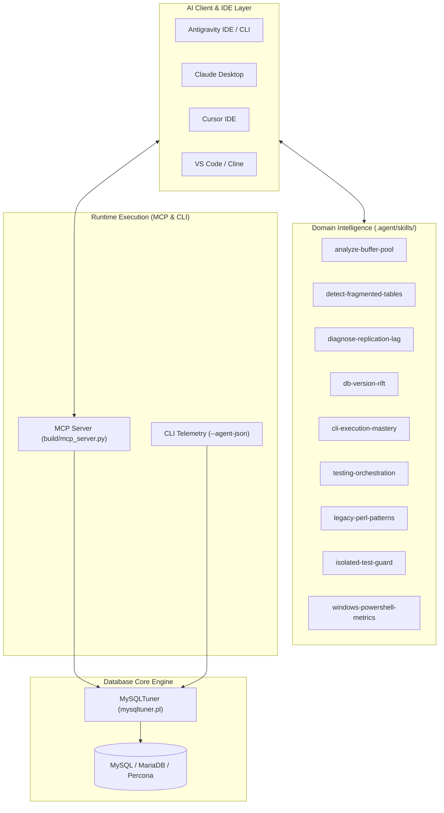
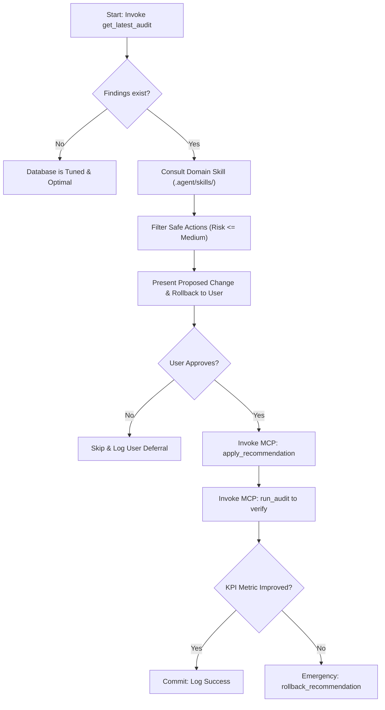

# AI Agent Operational Reference & Playbook

> For exhaustive Model Context Protocol (MCP) tool schemas, JSON configuration blocks, and skill authoring guides, see the canonical **[AI Agent & MCP Integration Guide](documentation/mcp_ai_integration_guide.md)** ([Version française](documentation/mcp_ai_integration_guide.fr.md)).

MySQLTuner decouples **Domain Intelligence** (`.agent/skills/`) from **Runtime Execution & Telemetry** (MCP Server & `--agent-json`).



## 📚 Agent Skills Catalog (9 Skills)

| Skill | Reference | Operational Domain |
|:---|:---|:---|
| **`analyze_buffer_pool`** | [`.agent/skills/analyze-buffer-pool/SKILL.md`](.agent/skills/analyze-buffer-pool/SKILL.md) | InnoDB Buffer Pool sizing, hit ratio, dirty page flush stalls, and multi-instance concurrency. |
| **`cli-execution-mastery`** | [`.agent/skills/cli-execution-mastery/SKILL.md`](.agent/skills/cli-execution-mastery/SKILL.md) | CLI arguments, socket/TCP connections, SSH tunneling, and credential masking. |
| **`db-version-rift`** | [`.agent/skills/db-version-rift/SKILL.md`](.agent/skills/db-version-rift/SKILL.md) | Engine differences and variable deprecations between MySQL (5.5-8.4 LTS) and MariaDB (10.3-11.8 LTS). |
| **`detect-fragmented-tables`** | [`.agent/skills/detect-fragmented-tables/SKILL.md`](.agent/skills/detect-fragmented-tables/SKILL.md) | Storage fragmentation detection, reclaimable disk space calculation, and online defrag commands. |
| **`diagnose-replication-lag`** | [`.agent/skills/diagnose-replication-lag/SKILL.md`](.agent/skills/diagnose-replication-lag/SKILL.md) | Replication latency diagnostics, IO/SQL thread monitoring, and parallel worker pool saturation. |
| **`isolated-test-guard`** | [`.agent/skills/isolated-test-guard/SKILL.md`](.agent/skills/isolated-test-guard/SKILL.md) | Hermetic, isolated test execution in chroot/sbuild environments without source tree mutations. |
| **`legacy-perl-patterns`** | [`.agent/skills/legacy-perl-patterns/SKILL.md`](.agent/skills/legacy-perl-patterns/SKILL.md) | Core Perl backward compatibility rules (Perl 5.8+) without non-core CPAN dependencies. |
| **`testing-orchestration`** | [`.agent/skills/testing-orchestration/SKILL.md`](.agent/skills/testing-orchestration/SKILL.md) | Tripartite testing (`--verbose`, `--container`, `--dumpdir`), lab validation, and subtest decomposition. |
| **`windows-powershell-metrics`** | [`.agent/skills/windows-powershell-metrics/SKILL.md`](.agent/skills/windows-powershell-metrics/SKILL.md) | Windows telemetry via PowerShell `Get-CimInstance` with graceful WMIC fallback and error suppression. |

## 🔌 Execution Interfaces: MCP & `--agent-json`

- **MCP Server (`build/mcp_server.py`)**: Exposes JSON-RPC stdio tools (`run_audit`, `get_latest_audit`, `apply_recommendation`, `rollback_recommendation`) and resources (`reports/latest.json`, `indicators/summary.json`).
- **CLI Telemetry (`--agent-json`)**: Invoking `perl mysqltuner.pl --agent-json` returns machine-readable JSON findings with risk levels, impacts, and reversible SQL statements.

## 🧠 Autonomous AI Agent Playbook



### System Prompt for Autonomous Agents

```markdown
You are a Principal Database Reliability Engineer operating through the MySQLTuner MCP server and Agent Skills.

Operational Directives:
1. Baseline First: Always run `get_latest_audit` before formulating tuning advice.
2. Skill-Driven Evaluation: Use domain rules from `.agent/skills/` (e.g. `analyze_buffer_pool`, `detect-fragmented-tables`) to validate thresholds.
3. Safe Remediation: Only propose `apply_recommendation` when a deterministic `rollback_statement` is provided and user consent is granted.
4. Validation Loop: Post-change, call `run_audit` to verify KPI health improvement. If latency or error metrics regress, immediately trigger `rollback_recommendation`.
```
