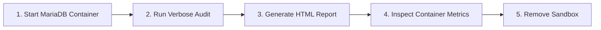

# Tutorial: First MySQLTuner Audit Sandbox

> **Learning Goal:** Spin up a disposable MariaDB container, run a full verbose
> MySQLTuner audit, generate a standalone HTML dashboard report, and clean up
> the sandbox cleanly.
>
> **Environment Warning:** Run this tutorial only in an isolated local Docker
> sandbox. Never run tutorial commands against staging or production database
> servers.

## Prerequisites

Make sure your workstation has the following tools ready before starting:

- Docker Engine 24+ (or compatible container runtime)
- Perl 5.6+ (core modules only; no CPAN installs required)
- MySQL or MariaDB command-line client (`mysql` or `mariadb`)
- Local repository checkout of `MySQLTuner-perl`
- Local TCP port `13306` available

## What You Will Accomplish

By the end of this tutorial, you will have:

1. Launched an isolated MariaDB 11.4 sandbox container on port `13306`.
2. Executed `perl mysqltuner.pl --verbose` to inspect storage engines, health
   score, and recommendations.
3. Generated a self-contained HTML diagnostic report using `--reportfile`.
4. Audited the container directly via `--container` and removed the sandbox
   cleanly.

## Sandbox Workflow Overview



## Step 1: Start an Isolated MariaDB Sandbox

Launch a temporary MariaDB 11.4 container with a sandbox password and wait
until it accepts queries:

```bash
docker run -d \
  --name mt-sandbox-db \
  -e MARIADB_ROOT_PASSWORD=sandbox_pass \
  -p 13306:3306 \
  mariadb:11.4
```

Verify that the database responds inside the container:

```bash
docker exec mt-sandbox-db mariadb -uroot -psandbox_pass \
  -e "SELECT VERSION() AS mariadb_version, @@port AS port;"
```

Expected output:

```mysql
+--------------------+------+
| mariadb_version    | port |
+--------------------+------+
| 11.4.x-MariaDB-... | 3306 |
+--------------------+------+
1 row in set (0.001 sec)
```

## Step 2: Run Your First Verbose Audit

Execute `mysqltuner.pl` from the repository root with `--verbose` and
`--forcemem` so MySQLTuner knows the simulated host RAM allocation for accurate
buffer recommendations:

```bash
perl mysqltuner.pl \
  --host 127.0.0.1 \
  --port 13306 \
  --user root \
  --pass sandbox_pass \
  --forcemem 4G \
  --verbose
```

Expected output (abbreviated):

```text
 >>  MySQLTuner 2.9.4
         * Jean-Marie Renouard <jmrenouard@gmail.com>
         * Major Hayden <major@mhtx.net>
 >>  Bug reports, feature requests, and downloads at http://mysqltuner.pl/
 >>  Run with '--help' for additional options and output filtering

-------- Storage Engine Statistics -----------------------------------------------------------------
[--] Status: +Aria +CSV +InnoDB +MEMORY +MyISAM +SEQUENCE
[--] Data in InnoDB tables: 0B (Tables: 0)
...
-------- Health Score KPI --------------------------------------------------------------------------
Overall Weighted Health Score: 75/100
    - Performance: 25/40
    - Security:    20/30
    - Resilience:  30/30
[--] Your database health is good, but there's room for improvement.

-------- Recommendations ---------------------------------------------------------------------------
General recommendations:
    MySQL started within last 24 hours - recommendations may be inaccurate
    Performance_schema should be activated.
```

Notice two helpful things right away: MySQLTuner flags when uptime is under 24
hours, and it summarizes a Weighted Health Score out of 100 across Performance,
Security, and Resilience.

## Step 3: Generate a Standalone HTML Report

MySQLTuner builds an interactive HTML dashboard in pure Perl with zero external
dependencies. Run the audit again with `--reportfile` to save a self-contained
report:

```bash
perl mysqltuner.pl \
  --host 127.0.0.1 \
  --port 13306 \
  --user root \
  --pass sandbox_pass \
  --forcemem 4G \
  --reportfile /tmp/sandbox_report.html
```

Verify that MySQLTuner created the HTML file:

```bash
ls -lh /tmp/sandbox_report.html
```

Expected output:

```text
-rw-r--r-- 1 user user 42K Nov 23 12:00 /tmp/sandbox_report.html
```

Open `/tmp/sandbox_report.html` in any browser to view the Health Score gauge,
category breakdowns, and collapsible console output.

## Step 4: Audit the Container Directly with `--container`

Instead of passing host RAM manually, pass `--container` to let MySQLTuner
inspect cgroup memory limits and container logs directly through Docker:

```bash
perl mysqltuner.pl \
  --container docker:mt-sandbox-db \
  --host 127.0.0.1 \
  --port 13306 \
  --user root \
  --pass sandbox_pass \
  --verbose
```

In container mode, MySQLTuner automatically skips host kernel recommendations
(`sysctl`) that do not apply inside an isolated container.

## Step 5: Clean Up the Sandbox

Remove the temporary container and generated report file once you finish
exploring:

```bash
docker rm -f mt-sandbox-db
rm -f /tmp/sandbox_report.html
```

Expected output:

```text
mt-sandbox-db
```

## Next Steps

- Run audits over SSH, Podman, or Kubernetes in
  [How-To Guides](../02-how-to-guides/index.md) or go directly to
  [Remote and Container Audits](../02-how-to-guides/deployment/run-remote-and-container-audit.md)
- Inspect every flag and environment variable in
  [Reference](../03-reference/index.md) and
  [CLI Options & Environment](../03-reference/cli-and-scripts/cli-options.md)
- Learn how the Weighted Health Score and version checks work in
  [Explanation](../04-explanation/index.md) and
  [Health Score & Version Rift](../04-explanation/deep-dives/health-score-and-version-rift.md)
