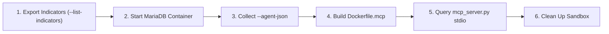

# Tutorial: AI Agent & MCP Sandbox Lab

> **Learning Goal:** Produce machine-readable `--agent-json` remediation plans,
> export the offline indicator catalog, and interact with the MySQLTuner Model
> Context Protocol (MCP) server in an isolated local Docker sandbox.
>
> **Environment Warning:** Keep `READ_ONLY=true` during learning sessions and
> run all commands only against a disposable local Docker container. Never
> connect AI write tools to production servers during a tutorial.

## Prerequisites

Ensure your local environment includes:

- Docker Engine 24+
- Python 3.8+ (standard library only; zero external pip packages required for
  `build/mcp_server.py`)
- Perl 5.6+ with `JSON::PP` (included in Perl core since 5.14)
- Local repository checkout of `MySQLTuner-perl`
- Local TCP port `13306` available

## What You Will Accomplish

By the end of this lab, you will have:

1. Inspected MySQLTuner's offline indicator catalog with `--list-indicators`.
2. Launched a temporary MariaDB 11.4 container and extracted actionable fixes
   via `--agent-json`.
3. Built the containerized MCP server image from `Dockerfile.mcp`.
4. Sent JSON-RPC 2.0 `initialize`, `tools/list`, and `tools/call` requests to
   `build/mcp_server.py` over stdio.

## Lab Execution Flow



## Step 1: Export the Offline Indicator Catalog

Before starting a database, test offline indicator discovery. This flag needs
no database connection:

```bash
perl mysqltuner.pl --list-indicators | head -n 25
```

Expected output:

```json
{
   "cli_options" : {
      "agent-json" : {
         "cat" : "PERFORMANCE",
         "default" : 0,
         "desc" : "Print result as actionable JSON schema for AI agents",
         "placeholder" : null,
         "type" : "!"
      },
```

## Step 2: Start the Sandbox Database and Collect `--agent-json`

Start a disposable MariaDB 11.4 container on port `13306`:

```bash
docker run -d \
  --name mt-mcp-sandbox \
  -e MARIADB_ROOT_PASSWORD=sandbox_pass \
  -p 13306:3306 \
  mariadb:11.4
```

Wait until the server accepts queries, then run `mysqltuner.pl` with
`--agent-json`:

```bash
perl mysqltuner.pl \
  --agent-json \
  --host 127.0.0.1 \
  --port 13306 \
  --user root \
  --pass sandbox_pass \
  --forcemem 4G
```

Expected output (abbreviated JSON structure):

```json
{
  "findings": [
    {
      "id": "performance_schema_enable",
      "topic": "Performance",
      "description": "Performance Schema is disabled.",
      "impact_score": 8,
      "risk_level": "Medium",
      "requires_restart": true,
      "action": {
        "type": "Config",
        "statement": "performance_schema = ON",
        "rollback_statement": "performance_schema = OFF"
      }
    }
  ]
}
```

Every finding includes `impact_score`, `risk_level`, `requires_restart`, and a
matching `rollback_statement` so AI agents can evaluate safety before proposing
any change.

## Step 3: Build the `Dockerfile.mcp` Microservice Image

Inspect `Dockerfile.mcp` and build a local `mysqltuner-mcp` image from the
repository root:

```bash
docker build -f Dockerfile.mcp -t mysqltuner-mcp .
```

Expected output (final lines):

```text
=> exporting to image
=> => naming to docker.io/library/mysqltuner-mcp:latest
```

## Step 4: Query `build/mcp_server.py` Over JSON-RPC Stdio

Run `build/mcp_server.py` locally in safe `READ_ONLY=true` mode against your
sandbox database and send three JSON-RPC requests over standard input:

```bash
mkdir -p /tmp/mt-mcp-cache
printf '%s\n%s\n%s\n' \
  '{"jsonrpc":"2.0","method":"initialize","id":1}' \
  '{"jsonrpc":"2.0","method":"tools/list","id":2}' \
  '{"jsonrpc":"2.0","method":"tools/call","id":3,"params":{"name":"analyze_buffer_pool","arguments":{"target_ram_percentage":75}}}' \
| DB_HOST=127.0.0.1 DB_PORT=13306 DB_USER=root DB_PASSWORD=sandbox_pass \
  CACHE_DIR=/tmp/mt-mcp-cache READ_ONLY=true MYSQLTUNER_PL=./mysqltuner.pl \
  python3 build/mcp_server.py
```

Expected output (three JSON-RPC response lines):

```json
{"jsonrpc": "2.0", "result": {"protocolVersion": "2024-11-05", "capabilities": {"tools": {}, "resources": {}, "prompts": {}}, "serverInfo": {"name": "mysqltuner-mcp", "version": "2.9.4"}}, "id": 1}
{"jsonrpc": "2.0", "result": {"tools": [{"name": "get_latest_audit", ...}, {"name": "run_audit", ...}, {"name": "analyze_buffer_pool", ...}, {"name": "diagnose_replication_lag", ...}, {"name": "detect_fragmented_tables", ...}, {"name": "apply_recommendation", ...}, {"name": "rollback_recommendation", ...}]}, "id": 2}
{"jsonrpc": "2.0", "result": {"content": [{"type": "text", "text": "{\n  \"status\": \"OPTIMAL\",\n  \"metrics\": {\n    \"hit_ratio_pct\": 100.0,\n..."}]}]}, "id": 3}
```

With `READ_ONLY=true`, diagnostic tools (`run_audit`, `get_latest_audit`,
`analyze_buffer_pool`, `diagnose_replication_lag`, `detect_fragmented_tables`)
succeed while write tools (`apply_recommendation`, `rollback_recommendation`)
safely refuse execution.

## Step 5: Clean Up the Sandbox

Remove the temporary container and MCP cache directory:

```bash
docker rm -f mt-mcp-sandbox
rm -rf /tmp/mt-mcp-cache
```

## Next Steps

- Apply safe operational procedures in
  [How-To Guides](../02-how-to-guides/index.md)
- Review every MCP tool, resource URI, and `--agent-json` field in
  [Reference](../03-reference/index.md) and
  [MCP Server & Agent JSON API](../03-reference/cli-and-scripts/mcp-server-api.md)
- Explore how `.agent/skills/` and `build/mcp_server.py` interact in
  [Explanation](../04-explanation/index.md) and
  [AI Agent Architecture](../04-explanation/architecture-overview/ai-agent-architecture.md)
