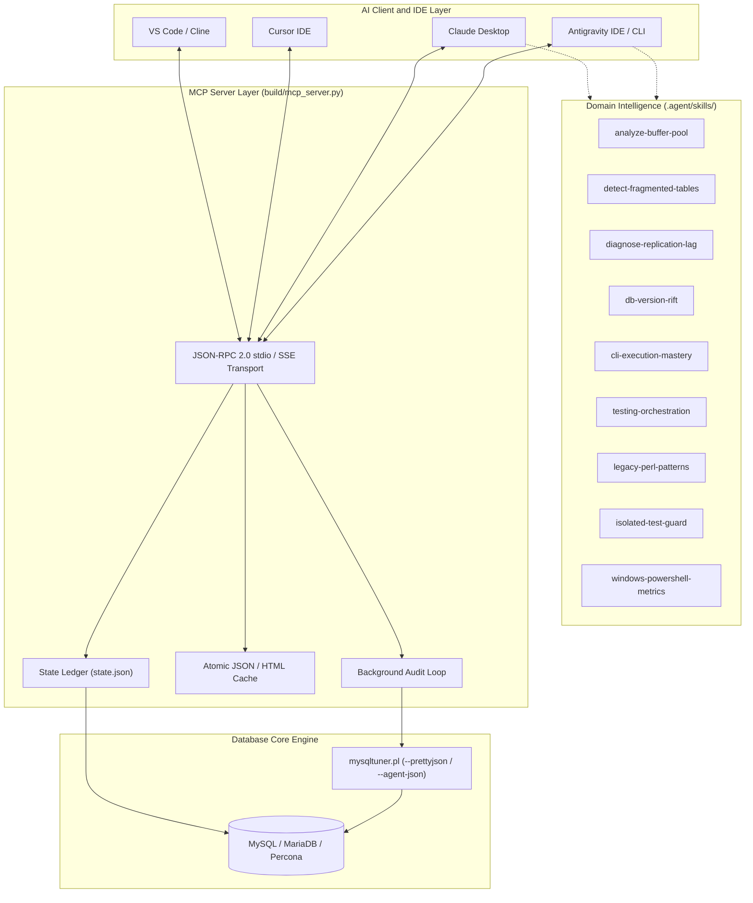

# AI Agent and MCP Subsystem Architecture

MySQLTuner separates **Domain Intelligence** (`.agent/skills/`) from
**Runtime Execution and Telemetry** (`build/mcp_server.py` and
`mysqltuner.pl --agent-json`) so autonomous agents can audit and tune databases
safely.

## System Topology

## Domain Intelligence Layer (`.agent/skills/`)

Nine specialized skill capsules in `.agent/skills/` provide mathematical
formulas, version-divergence guards, and operational safety boundaries:

| Skill Directory | Operational Scope |
| :--- | :--- |
| `analyze-buffer-pool` | InnoDB buffer pool hit ratio, dirty-page ratio, and multi-instance sizing |
| `detect-fragmented-tables` | `DATA_FREE` fragmentation ratios and lock-aware defragmentation rules |
| `diagnose-replication-lag` | IO/SQL thread inspection, GTID state, and parallel worker saturation |
| `db-version-rift` | Variable renames and command divergence across MySQL and MariaDB releases |
| `cli-execution-mastery` | Connection transport flags, SSH tunneling, and credential hygiene |
| `testing-orchestration` | Tripartite lab validation and `prove` subtest decomposition |
| `legacy-perl-patterns` | Core-only Perl backward compatibility constraints |
| `isolated-test-guard` | Hermetic chroot/sbuild execution without source-tree mutations |
| `windows-powershell-metrics` | PowerShell `Get-CimInstance` telemetry with `wmic` fallback |

## MCP Server Execution Model (`build/mcp_server.py`)

`build/mcp_server.py` implements MCP `2024-11-05` over `JSON-RPC 2.0` using
Python 3 standard library modules only:

- **Dual Transport**: Serves `stdio` by default for desktop IDE clients, or HTTP
  Server-Sent Events (`--sse`) with `/sse`, `/message`, and `/health` endpoints.
- **Unauthenticated Guard**: When `--sse` starts without `MCP_AUTH_TOKEN`,
  `READ_ONLY` is forced to `true` so HTTP clients cannot mutate database state.
- **Atomic Cache**: `run_audit` and the periodic daemon thread write
  `latest.json` and `latest.html` via temporary files and atomic `os.replace()`.
- **Fail-Closed Queries**: Targeted tools (`analyze_buffer_pool`,
  `diagnose_replication_lag`, `detect_fragmented_tables`) fail closed on SQL
  errors instead of returning synthetic metrics.
- **SQL Sanitization**: `apply_recommendation` runs `sanitize_sql_statement()`
  to strip comments, block multi-statement payloads and destructive verbs, and
  enforce an explicit command prefix allowlist.
- **State Ledger**: Before executing SQL, `apply_recommendation` records
  `@@global.<variable_name>` in `$CACHE_DIR/state.json` so
  `rollback_recommendation` can emit an exact reverse `SET GLOBAL` statement.

## `--agent-json` Design (`mysqltuner.pl`)

For daemonless pipelines, `perl mysqltuner.pl --agent-json` converts `@adjvars`
tuning recommendations into structured JSON findings:

- **Static vs Dynamic Classification**: `is_static_config_var()` marks
  restart-bound parameters (`performance_schema`, `innodb_log_file_size`,
  `innodb_buffer_pool_instances`) with `requires_restart: true` and
  `action.type: "Config"`.
- **Runtime SQL Actions**: Runtime-mutable variables emit `action.type: "SQL"`
  (`SET GLOBAL ...;`) with `requires_restart: false`.
- **Sysctl and Dot-Key Filtering**: Keys containing dots (Linux `sysctl` or
  Galera `gcs.fc_*` options) are excluded from SQL `SET GLOBAL` generation so
  agents never attempt invalid SQL assignments.
- **Deterministic Reversibility**: Every finding pairs `action.statement` with
  `action.rollback_statement` populated from the pre-audit `%myvar` snapshot.

## Related Documentation

- MCP tool schemas and `--agent-json` risk matrix:
  [MCP Server and Agent JSON API](../../03-reference/cli-and-scripts/mcp-server-api.md)
- Guided local MCP workshop:
  [AI and MCP Sandbox Lab](../../01-tutorials/02-ai-mcp-sandbox-lab.md)
