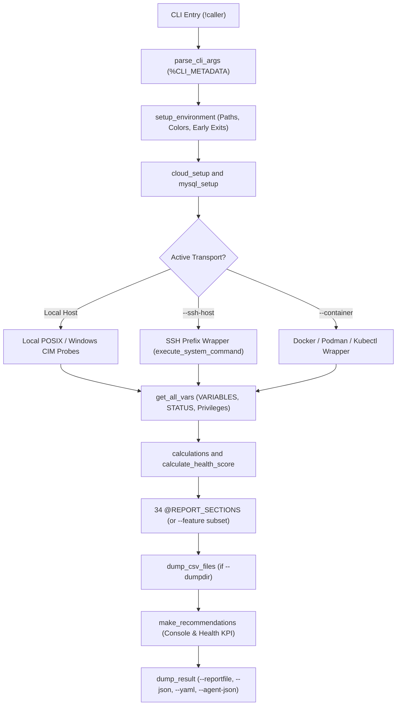

# Diagnostic Execution Pipeline and Transport Abstraction

Analytical overview of how `mysqltuner.pl` initializes transports, collects SQL and OS telemetry, computes metrics, and
serializes diagnostic outputs within a single-pass Perl lifecycle.

## Execution Lifecycle Architecture

## CLI Initialization and Early Exits

`mysqltuner.pl` drives argument parsing from a declarative `%CLI_METADATA` registry using `Getopt::Long` configured with
`no_auto_abbrev` and `no_ignore_case`. Strict boundary checks reject unrecognized flags and positional arguments before
any network or filesystem call occurs.

`setup_environment()` resolves human-readable sizing flags (`--forcemem`, `--forceswap`) via `parse_human_size_to_mb()`,
locates `basic_passwords.txt` and `vulnerabilities.csv`, and handles offline exits (`--help` and
`--list-indicators`).

## Credential Resolution and Fail-Fast Semantics

`mysql_setup()` resolves database connectivity before running OS telemetry so unreachable servers terminate cleanly:

- **Explicit Credentials**: `--user`, `--pass`, `--login-path`, or `--container` attempts immediate authentication. When
  explicit `--pass` or `--login-path` credentials fail, `report_login_failure()` prints the client error (`ERROR 2026`
  TLS hint or `ERROR 2002-2005` network hint) and exits `1` without falling back to unrelated credential stores.
- **Platform Discovery**: On local hosts (`$doremote == 0`), `mysql_setup()` checks Solaris `svcprop`, Plesk
  `.psa.shadow`, DirectAdmin `mysql.conf`, Debian `/etc/mysql/debian.cnf`, and `--defaults-file` before attempting
  `~/.my.cnf` / `~/.mylogin.cnf` or interactive `STDIN` prompting (disabled by `--noask`).

## Transport Abstraction (`execute_system_command`)

OS-level discovery routes through `execute_system_command()`, which consults `get_transport_prefix()`
(`get_ssh_prefix()` first, then `get_container_prefix()`):

- **Shell Isolation**: Remote commands are wrapped in single-quoted remote shells with embedded single quotes escaped
  (`[REQ-INFRA-02]`), while SQL statements passed through `select_array()` and `select_one()` escape double quotes,
  backticks, and dollar signs (`[REQ-INFRA-01]`).
- **Environment Awareness**: In container mode (`is_docker()` or `--container`), `os_setup()` reads cgroup v1/v2 memory
  ceilings (`detect_cgroup_memory_limits()`) and `system_recommendations()` suppresses host kernel, process, and network
  probes that reflect the underlying container host rather than the database allocation.
- **Windows Telemetry**: On `$^O eq 'MSWin32'`, `os_setup()` and `check_architecture()` invoke PowerShell
  `Get-CimInstance` first and fall back to legacy `wmic` only when CIM output is missing or non-numeric.

## Metric Computation, Diagnostics, and Serialization

- **Snapshot Acquisition**: `get_all_vars()` executes `SELECT VERSION()` (with 3 connection retries), loads
  `SHOW GLOBAL VARIABLES` and `SHOW GLOBAL STATUS` into `%myvar` and `%mystat`, checks user privileges, and adjusts
  `Aborted_connects` using the symlink-protected state file from `adjust_aborted_connects()`.
- **Derived Calculations**: `calculations()` verifies `Questions >= 1` (exiting `2` on idle servers), delegates pure
  buffer/memory/traffic/cache math to helper subroutines, and computes InnoDB and binlog ratios.
- **Sectional Audits**: The main loop executes all 34 subroutines in `@REPORT_SECTION_NAMES` (or a validated comma list
  via `--feature`), feeding `@generalrec`, `@adjvars`, `@secrec`, `@sysrec`, and `@modeling`.
- **Output Rendering**: `dump_result()` writes optional standalone HTML (`--reportfile`), credential-redacted JSON
  (`--json` / `--prettyjson` via Core `JSON::PP`), YAML (`--yaml`), or AI remediation JSON (`--agent-json`).

## Related Documentation

- Exact CLI flags, environment variables, and exit codes:
  [CLI Options and Environment](../../03-reference/cli-and-scripts/cli-options.md)
- Running SSH and container audits:
  [Run Remote and Container Audits](../../02-how-to-guides/deployment/run-remote-and-container-audit.md)
