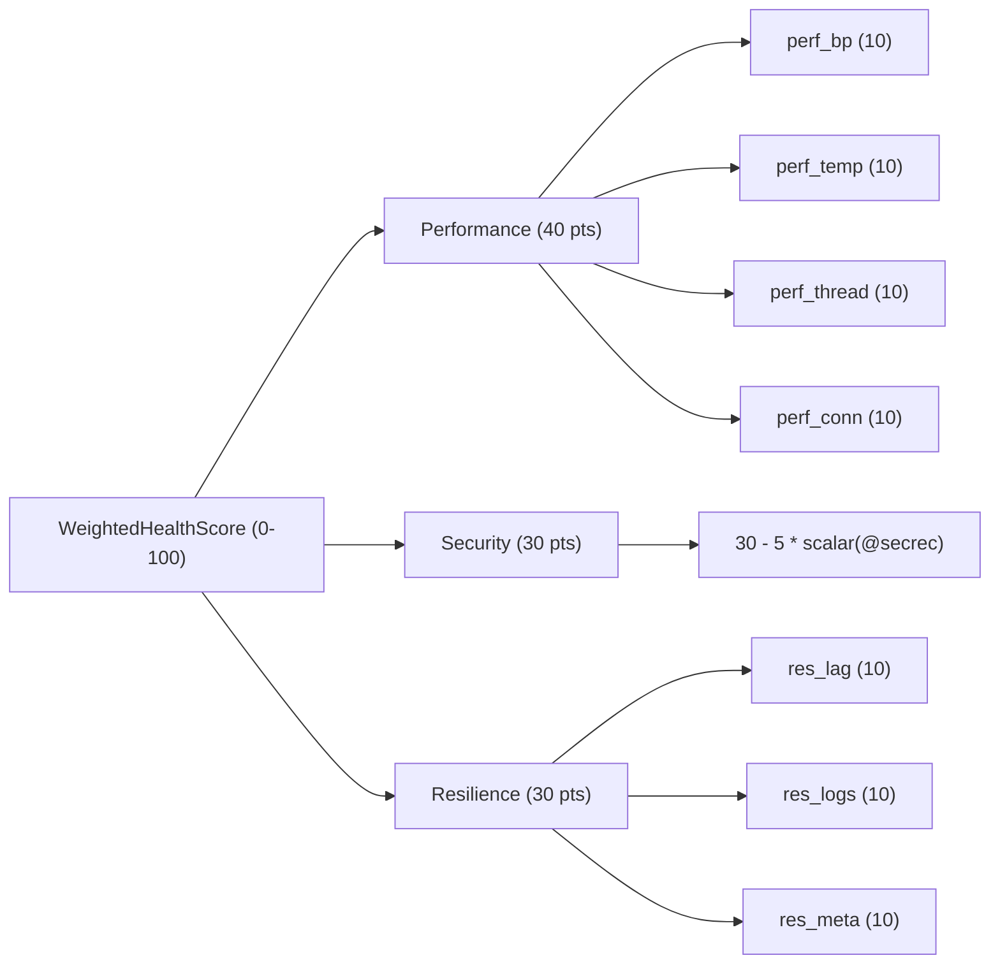

# Weighted Health Score Model and Engine Version Rift

Analytical deep dive into MySQLTuner's `40 / 30 / 30` composite health scoring
model and its version-disambiguation architecture across MySQL
(`5.7` to `9.x` / `26.10`) and MariaDB (`10.x` to `13.0`).

## Weighted Health Score (`40 / 30 / 30`) Analytical Model

Single-metric alerts fail to convey overall server posture when a database has
healthy memory ratios alongside exposed authentication risks or broken
replication threads.

`calculate_health_score()` aggregates operational telemetry into a bounded
`0` to `100` index across three weighted pillars:

### Design Mechanics and Neutral Fallbacks

- **Performance (`40` points)**: Four orthogonal indicators (`perf_bp`,
  `perf_temp`, `perf_thread`, `perf_conn`) each contribute `0`, `5`, or `10`
  points (`perf_conn` is binary `10` below `80%` and `0` at or above `80%`).
- **Neutral Fallbacks**: When a metric is undefined (for example, an unexercised
  cache), `calculate_health_score()` assigns `5` points rather than penalizing
  an inactive feature with `0`.
- **Security (`30` points)**: Starts at `30` and subtracts `5` points per
  `@secrec` entry (covering unencrypted sessions, weak TLS/ciphers, anonymous
  users, empty passwords, and deprecated auth plugins), floored at `0`.
- **Resilience (`30` points)**: Combines replication lag (`res_lag`: `10` pts
  standalone or `< 1s`, `5` pts `1..59s`, `0` pts stopped or `>= 60s`), redo log
  sizing (`res_logs`: `-5` pts), and modeling health (`res_meta`: `-5` if
  `> 5`).
- **Complementary KPIs**: `calculate_sectional_health_scores()` emits five
  `0` to `100` domain scores (`General`, `Storage`, `Security`, `Replication`,
  `Modeling`) and a `ResourceSaturation` vector (`CPU`, `Memory`, `Connections`,
  `IO`).

## MySQL vs MariaDB Version Rift Analysis

MySQL and MariaDB diverged substantially after MySQL 5.7 and MariaDB 10.0,
making naive `major.minor` version checks unsafe when a single script targets
both ecosystems.

### Authoritative Engine Disambiguation (`is_mariadb()`)

Historically, `calculations()` stripped vendor suffixes from `$myvar{'version'}`
(`s/(.+)-.*?$/$1/`) after storing the original string in
`$real_vars{'version'}`.

Once MySQL introduced calendar-style releases (`26.7`, `26.10`) alongside
MariaDB `10.x` to `13.0`, checking `major >= 10` alone misclassified MySQL
`26.x`.

`is_mariadb()` resolves this ambiguity in three deterministic stages:

1. Match `mariadb` case-insensitively in `$myvar{'version'}` or
   `$myvar{'version_comment'}` (returning `1`), or match
   `mysql|percona|oracle|aurora` (returning `0`).
2. Compare the unstripped `$real_vars{'version'}` base prefix when `-MariaDB`
   was stripped during `calculations()`.
3. Fall back to numeric major bounds `( $maj >= 10 && $maj < 26 )`, which
   isolates MariaDB `10.x` to `13.x` from MySQL `5.5` to `9.x` and `26.x`.

### Cross-Engine Divergence Points in `mysqltuner.pl`

| Subsystem | MySQL (`5.7` to `9.x` / `26.10`) | MariaDB (`10.x` to `13.0`) | Diagnostic Adaptation |
| :--- | :--- | :--- | :--- |
| Replication Commands | `SHOW REPLICA STATUS` (>= `8.0.22`); `SHOW SLAVE STATUS` (< `8.0.22`) | `SHOW REPLICA STATUS` (>= `10.5`); `SHOW SLAVE STATUS` (< `10.5`) | Probes `REPLICA` variables and falls back to `SLAVE` equivalents |
| User Auth Store | `mysql.user` (`authentication_string`), `PASSWORD()` removed in `8.0+` | `mysql.global_priv` JSON (`Priv` column) in `10.4+` | Queries `JSON_VALUE(Priv, '$.plugin')` on MariaDB `10.4+`; uses Perl `Digest::SHA` offline |
| Auth Migration Target | Recommends `caching_sha2_password` (`mysql_native_password` removed in `9.0`) | Recommends `ed25519`, `parsec`, or `unix_socket` | `check_auth_plugins()` branches on `$is_mariadb` and `8.0`/`8.4`/`9.0` |
| TLS Availability Signal | `have_ssl` removed in `8.4+`; falls back to `Ssl_cipher` and `performance_schema.tls_channel_status` | `have_ssl`; `11.4+` supports zero-configuration TLS without explicit `ssl_cert`/`ssl_key` | `get_server_tls_status()` checks multi-signal fallback; skips cert warning on MariaDB `11.4+` auto-TLS |
| InnoDB Redo & BP | `innodb_redo_log_capacity` replaces `innodb_log_file_size` in `8.0.30+` | Retains `innodb_log_file_size`; removes `innodb_buffer_pool_instances` (`10.4+`) and autosizes chunk (`10.8+`) | Guards instance checks with `!(is_mariadb() && >= 10.4)` and skips chunk `0` on MariaDB `10.8+` |
| Query Cache & Variables | Query cache removed in `8.0`; `tx_isolation` removed in `8.0` | Query cache retained (`Com_select` includes `Qcache_hits`); `tx_isolation` deprecated `11.1+` | `audit_deprecated_variables()` checks `GLOBAL_VALUE_ORIGIN` so default MariaDB aliases do not false-positive |

## Related Documentation

- Compatibility tables and LTS cycles:
  [Supported Database Versions](../../03-reference/architecture-specs/supported-versions.md)
- Health Score points table and engine matrix:
  [Capabilities and Indicators](../../03-reference/architecture-specs/capabilities-and-indicators.md)
- Threshold values across engines:
  [Thresholds and Data Files](../../03-reference/configuration/thresholds-and-files.md)
